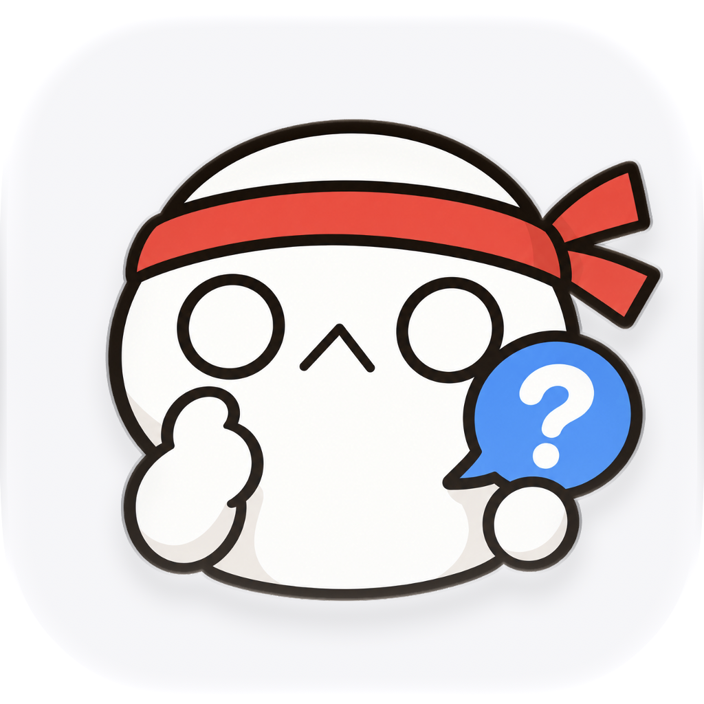

# 꼬꼬무 앱 아이콘

사용자가 선택한 빨간 머리띠 캐릭터와 A 화이트 배경을 사용한다. 배우자의 흰색 캐릭터, 빈 원형 눈과 작은 입을 참고하고 생각하는 손과 파란 질문 말풍선을 더했다.



`AppIcon.icon/Assets/mascot.png`는 처음 imagegen으로 만든 투명 전경 원본이다. 2026-10-12 배경을 `#F5F6F8`로 바꾸고 전경 배율을 1.0에서 0.78로 줄여 머리띠 매듭, 손과 말풍선의 여백을 확보했다. 캐릭터 원본은 다시 생성하거나 수정하지 않았다. 색, 배율과 시스템 재질은 `AppIcon.icon/icon.json`에서 지정한다.

## 앱에 적용하기

```sh
./scripts/compile-icon.sh
./scripts/package.sh
```

`Compiled/AppIcon.icns`와 `Compiled/Assets.car`를 앱 번들에 함께 넣는다. 소스와 컴파일 결과의 SHA-256을 `checksums.sha256`으로 확인하며, 원본을 수정하면 다시 컴파일해야 패키징 검사를 통과한다.

## README와 프로필 이미지

`Preview/AppIcon-default.png`는 Icon Composer의 `ictool`로 내보낸 1024px PNG다. 배우자와 동일하게 macOS, Default, scale 1, design generation 27 설정을 사용한다. ICNS에서 추출한 256px 이미지에는 시스템 바깥 여백이 포함되므로 공개용 이미지로 섞어 쓰지 않는다.

```sh
./scripts/export-icon-preview.sh
```

두 앱의 프로필 이미지는 96×96px, README 이미지는 160×160px로 표시한다. PNG는 공개 문서용이며 앱은 위의 네이티브 컴파일 자산을 사용한다.

제작 프롬프트와 당시 이름인 Tail은 [prompts.json](prompts.json)에 원문 그대로 보관한다. 변경 근거는 2026-10-12 확인한 [Apple Icon Composer 문서](https://developer.apple.com/documentation/xcode/creating-your-app-icon-using-icon-composer)의 위치와 배율, 기본 및 어두운 표시 안내다.
