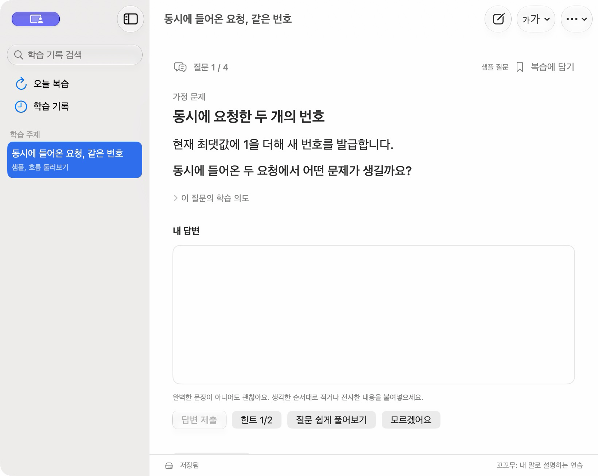
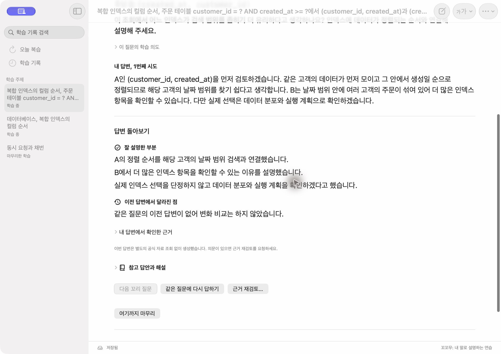
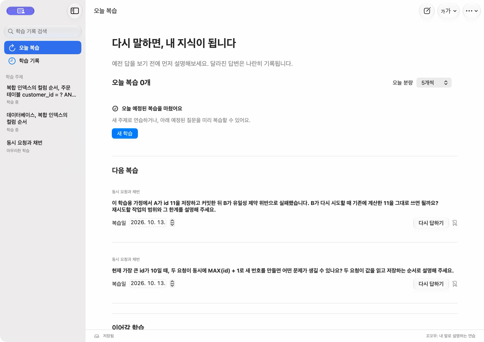

<p align="center">
  
</p>

<h1 align="center">꼬꼬무</h1>
<p align="center"><strong>Kkokkomu</strong></p>
<p align="center">
  내 말로 설명하고, 꼬리에 꼬리를 무는 질문으로 공부합니다.<br>
  CS 개념과 프로젝트 경험을 연습하는 macOS 학습 앱.
</p>

<p align="center">
  <a href="#시작하기">시작하기</a> &nbsp; / &nbsp;
  <a href="docs/usage.md">사용 안내</a> &nbsp; / &nbsp;
  <a href="docs/development.md">개발 안내</a>
</p>

<p align="center">
  <a href="docs/screenshots/kkokkomu-light.png"></a>
</p>
<p align="center"><sub>질문 하나에 집중하고, 떠오르는 생각을 자기 말로 적어보세요.</sub></p>

<p align="center">
  <a href="docs/screenshots/kkokkomu-feedback.png"></a>
  <a href="docs/screenshots/kkokkomu-review.png"></a>
</p>
<p align="center"><sub>내 답변 돌아보기 / 다시 답하며 복습하기</sub></p>

위 화면은 샘플 질문과 개인 기록이 없는 QA 보관함에서 촬영했습니다. 피드백은 기존 실제 AI 생성 결과입니다. [화면과 검증 기록](docs/qa.md)

## 이렇게 공부해요

1. **주제를 정합니다.** CS 개념이나 프로젝트 경험을 적으면 첫 질문이 나옵니다.
2. **내 말로 답합니다.** 직접 입력하거나 외부에서 전사한 내용을 붙여넣습니다.
3. **답변을 돌아봅니다.** 피드백을 읽고, 내 답변에 이어지는 꼬리 질문으로 더 깊이 설명합니다. 참고 답안과 해설은 원할 때 펼칩니다.
4. **다시 설명합니다.** 복습할 질문을 골라두고, 예전 답을 보기 전에 다시 답해봅니다.

기본 분량은 첫 질문 하나와 꼬리 질문 최대 세 개입니다. 중간에 마무리하거나 질문을 더 이어갈 수 있습니다.

## 막히는 순간부터 복습까지

- **힌트로 시작하기** — 말문이 막히면 힌트, 쉬운 설명이나 **모르겠어요**를 선택할 수 있습니다.
- **답변의 변화 남기기** — 같은 질문에 다시 답해도 이전 답변, 피드백과 참고 답안은 남습니다.
- **내 속도로 복습하기** — 1일, 3일, 7일 간격을 기본으로 자기평가에 따라 조정합니다. 복습 대상과 날짜도 바꿀 수 있습니다.
- **편하게 읽고 이어가기** — 글자 크기와 테마를 조절하고, 자동 저장된 초안부터 이어갑니다. 보관함 백업과 복원도 제공합니다.

## 시작하기

macOS 26 이상이 필요합니다. 빌드 도구 준비는 [개발 안내](docs/development.md)를 참고하세요.

```sh
git clone https://github.com/zzoe2346/kkokkomu.git
cd kkokkomu
./scripts/package.sh
open dist/꼬꼬무.app
```

처음에는 **샘플 둘러보기**로 로그인 없이 질문과 입력 화면을 살펴볼 수 있습니다.

AI 질문과 피드백은 기존 Codex CLI의 ChatGPT 로그인을 사용합니다. 앱 설정(⌘,)의 **연결 확인**에서 준비 상태를 확인한 뒤 **새 학습**을 시작하세요. 생성에는 인터넷 연결이 필요하며 Codex 사용 한도가 적용됩니다.

현재 실행을 확인한 환경은 Apple Silicon Mac입니다. 로컬 빌드는 ad-hoc 서명을 사용하며 공증된 배포본은 아닙니다. [검증 범위](docs/qa.md#확인-범위의-한계)

## 기록은 내 Mac에

학습 기록과 설정은 로컬에 보관합니다. AI 생성에는 선택한 주제, 경험과 필요한 답변 맥락이 전달됩니다. 개인 학습 기록과 백업은 이 저장소에 포함되지 않습니다.

개발 중 이름인 Tail에서 꼬꼬무로 바꾼 뒤에도 기존 기록과 설정을 그대로 사용합니다. 저장 위치, 백업과 복원, 단축키는 [사용 안내](docs/usage.md)에 정리했습니다.

## 개발과 문서

```sh
./scripts/check.sh
```

[요구사항](docs/requirements.md) / [구조와 데이터 계약](docs/lld.md) / [QA 기록](docs/qa.md) / [개발 지침](AGENTS.md) / [아이콘 제작 기록](Artwork/AppIcon/README.md)

주제로 교재와 시각자료를 만들고 싶다면, 함께 만든 학습 앱 [배우자 — Let’s Learn](https://github.com/zzoe2346/baeuja)도 살펴보세요.
